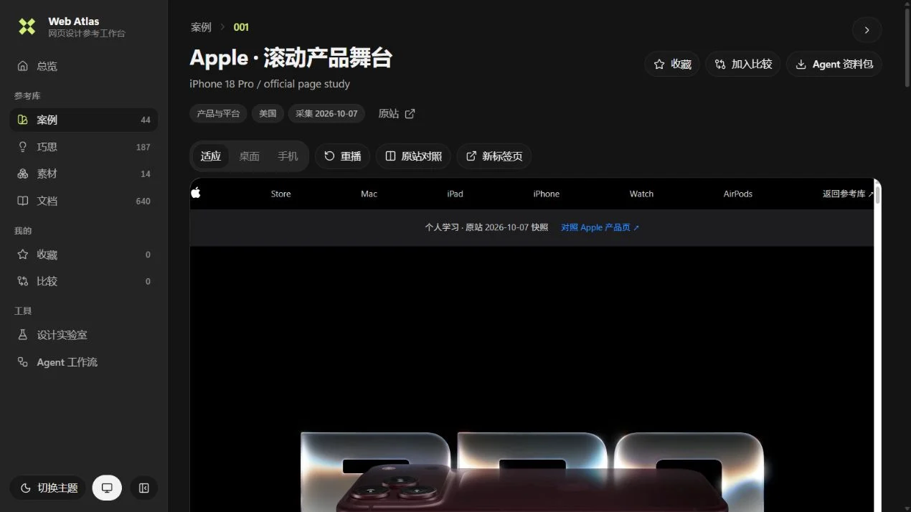
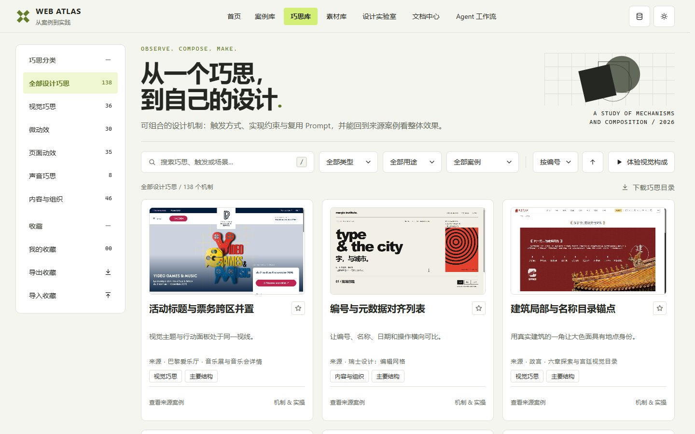
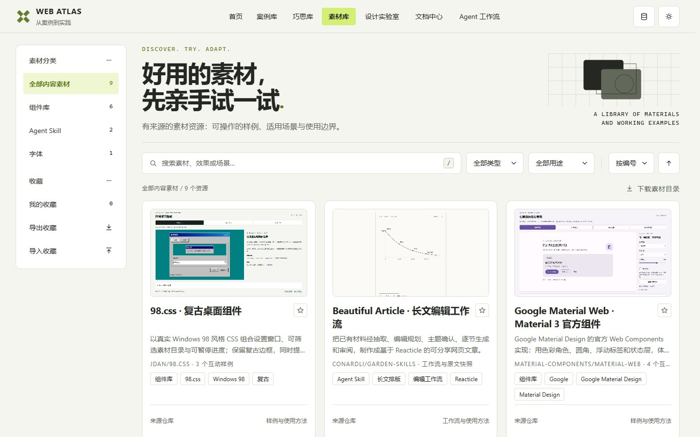

# WEB ATLAS

### 可交互 · 可查询 · 可回看的个人网页设计案例、巧思与素材库

从真实网站学习设计，让配色、排版、图像、形状和动效相互配合；从完整案例理解整体设计，把独立巧思组合成自己的设计；亲手试用组件与内容素材，取材时一并保留使用方式和授权边界。

<!-- atlas-counts:start -->
**44 个案例**　·　**187 个巧思**　·　**14 个素材**
<!-- atlas-counts:end -->

[打开首页](https://web-atlas.mibxranime.chatgpt.site) · [案例库](https://web-atlas.mibxranime.chatgpt.site/cases.html) · [巧思库](https://web-atlas.mibxranime.chatgpt.site/patterns.html) · [素材库](https://web-atlas.mibxranime.chatgpt.site/materials.html) · [设计实验室](https://web-atlas.mibxranime.chatgpt.site/lab.html) · [Agent 工作流](https://web-atlas.mibxranime.chatgpt.site/agent.html) · [文档中心](https://web-atlas.mibxranime.chatgpt.site/docs.html) · [完整索引](docs/cases/README.md)

案例提供完整作品，巧思拆解可借用的机制，素材提供可试用的组件与内容资源。

| 首页 | 案例库 |
| --- | --- |
|  |  |
| 巧思库 | 素材库 |
|  |  |

使用方式见[使用指南](docs/guide.md)，案例画廊与研究见[总览](docs/overview.md)，取用素材见[素材使用说明](docs/materials/README.md)。Agent 从[取材说明](docs/agent.md)和[结构化目录](agent/catalog.json)进入；也可使用[配套 skill](https://github.com/MIBXR/mibxr-skills/tree/main/skills/web-atlas)。

本地运行、收录规则与新增流程见[贡献指南](CONTRIBUTING.md)，修改仓库见[维护约束](AGENTS.md)。
