<div align="center">

# WEB ATLAS

### 可交互 · 可查询 · 可回看的个人网页设计案例、巧思与素材库

从真实网站学习设计，让配色、排版、图像、形状和动效相互配合；从完整案例理解整体设计，把独立巧思组合成自己的设计；亲手试用组件与内容素材，取材时一并保留使用方式和授权边界。

<!-- atlas-counts:start -->
**44 个案例**　·　**187 个巧思**　·　**15 个素材**
<!-- atlas-counts:end -->

[打开首页](https://web-atlas-library.mibxranime.chatgpt.site/#/) · [案例库](https://web-atlas-library.mibxranime.chatgpt.site/#/cases) · [巧思库](https://web-atlas-library.mibxranime.chatgpt.site/#/patterns) · [素材库](https://web-atlas-library.mibxranime.chatgpt.site/#/materials) · [设计实验室](https://web-atlas-library.mibxranime.chatgpt.site/#/tools/lab) · [Agent 工作流](https://web-atlas-library.mibxranime.chatgpt.site/#/tools/workflow) · [文档中心](https://web-atlas-library.mibxranime.chatgpt.site/#/docs)

<table>
<tr>
<td width="33%" align="center"><a href="https://web-atlas-library.mibxranime.chatgpt.site/#/cases/chatgpt-platform">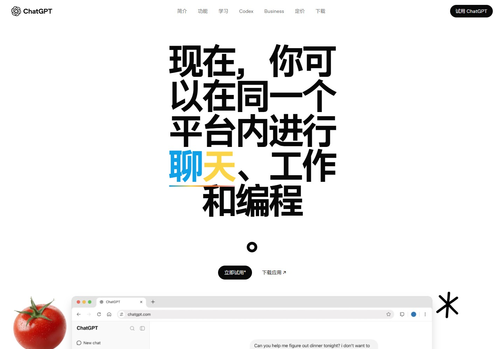</a><br><sub>ChatGPT · 产品交互</sub></td>
<td width="33%" align="center"><a href="https://web-atlas-library.mibxranime.chatgpt.site/#/cases/endfield-industrial">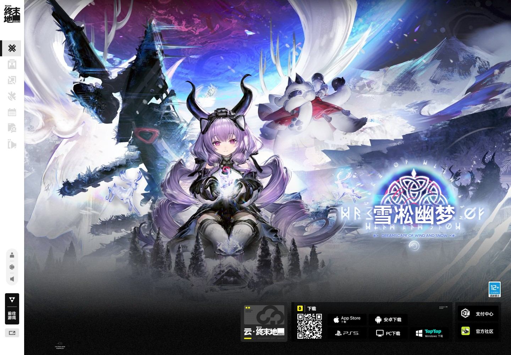</a><br><sub>终末地 · 工业档案</sub></td>
<td width="33%" align="center"><a href="https://web-atlas-library.mibxranime.chatgpt.site/#/cases/rijksmuseum-art">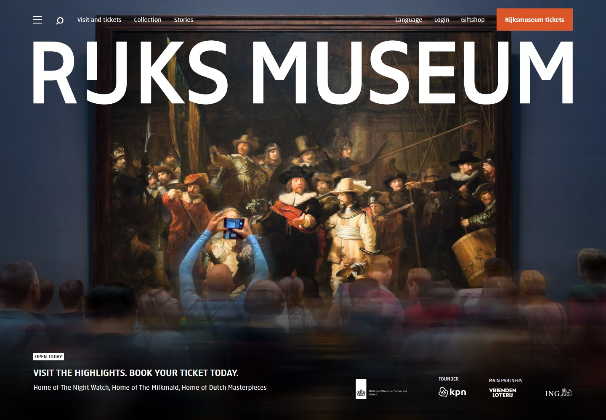</a><br><sub>Rijksmuseum · 艺术文化</sub></td>
</tr>
</table>

</div>

## 页面截图

| 首页 | 案例库 |
| --- | --- |
| 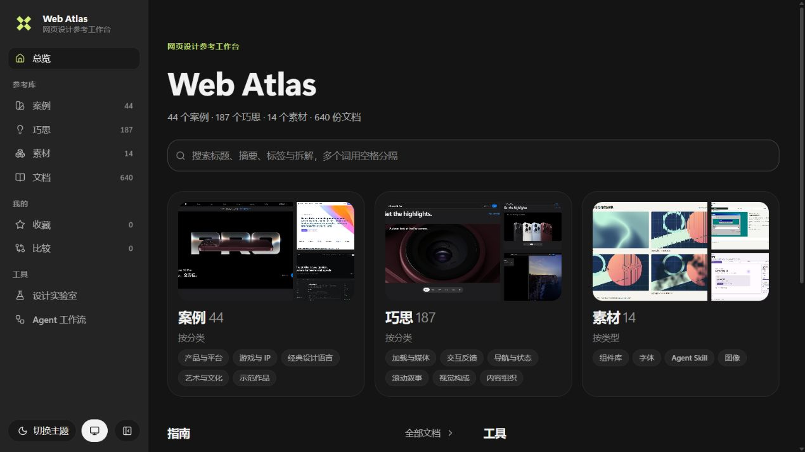 | 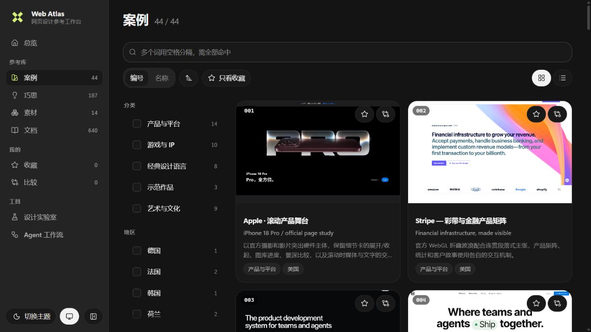 |
| 案例详情 | 巧思详情 |
|  | 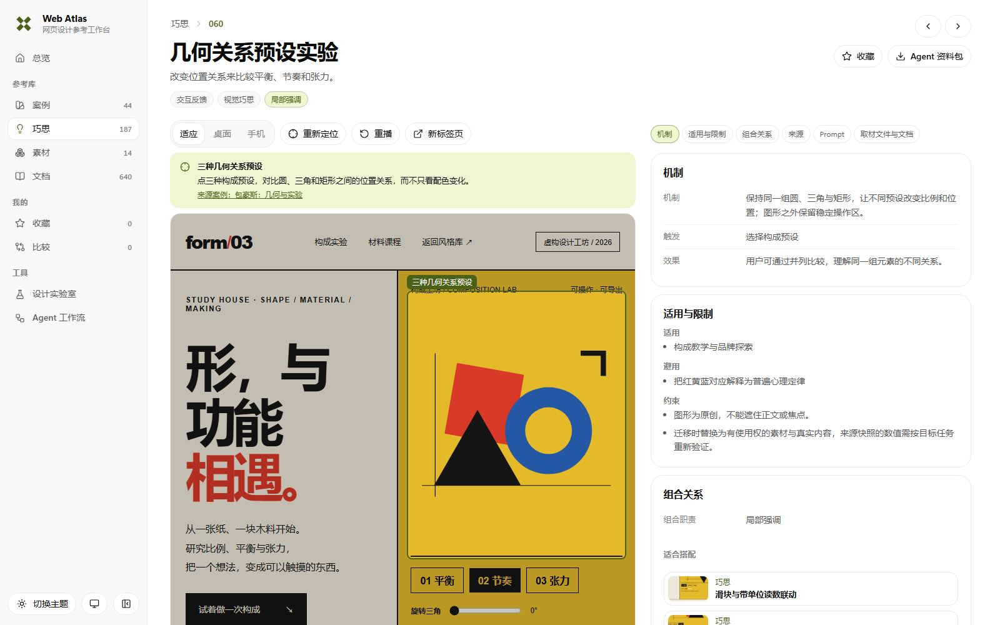 |
| 设计实验室 | 文档中心 |
| 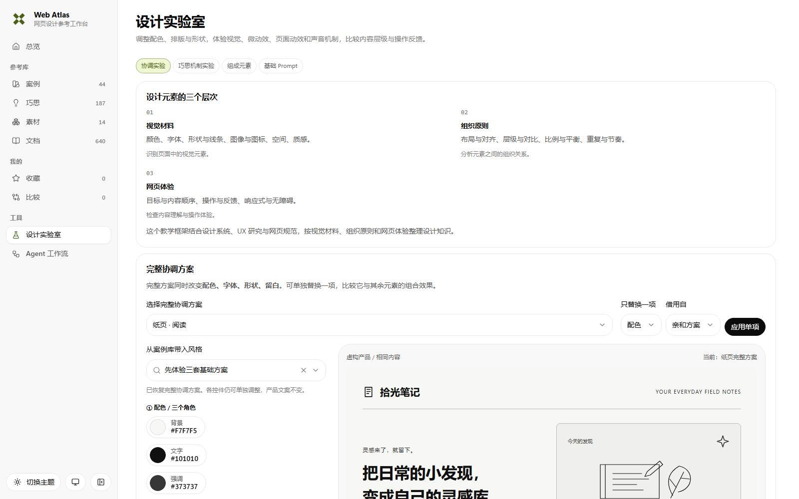 | 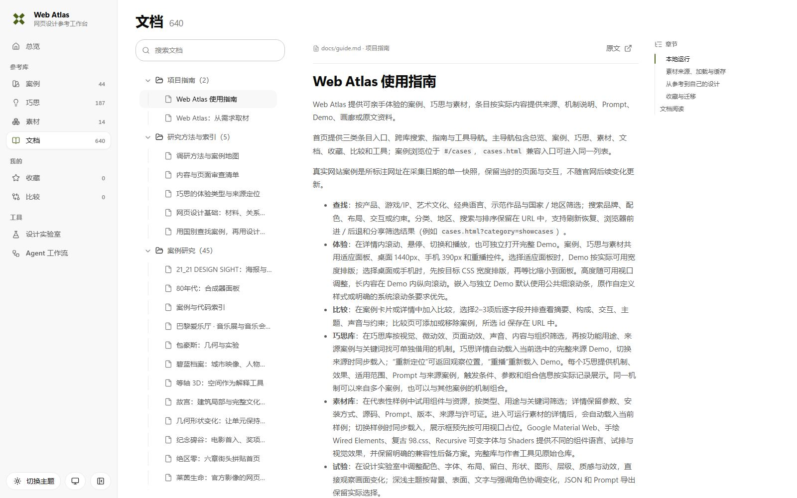 |

## 精选案例

<table>
<tr>
<td width="33%" valign="top"><br><strong><a href="https://web-atlas-library.mibxranime.chatgpt.site/#/cases/chatgpt-platform">ChatGPT</a></strong><br>巨字标题、飞入拼贴与产品窗口随滚动交接。<br><br><a href="prompts/cases/chatgpt-platform.md">Prompt</a> · <a href="docs/cases/chatgpt-platform.md">研究</a> · <a href="demos/cases/chatgpt-platform/">代码</a></td>
<td width="33%" valign="top"><br><strong><a href="https://web-atlas-library.mibxranime.chatgpt.site/#/cases/endfield-industrial">终末地</a></strong><br>八章工业科幻门户，干员目录与点云世界观。<br><br><a href="prompts/cases/endfield-industrial.md">Prompt</a> · <a href="docs/cases/endfield-industrial.md">研究</a> · <a href="demos/cases/endfield-industrial/">代码</a></td>
<td width="33%" valign="top"><br><strong><a href="https://web-atlas-library.mibxranime.chatgpt.site/#/cases/rijksmuseum-art">Rijksmuseum</a></strong><br>全幅名画摄影配巨大白色字标。<br><br><a href="prompts/cases/rijksmuseum-art.md">Prompt</a> · <a href="docs/cases/rijksmuseum-art.md">研究</a> · <a href="demos/cases/rijksmuseum-art/">代码</a></td>
</tr>
<tr>
<td width="33%" valign="top">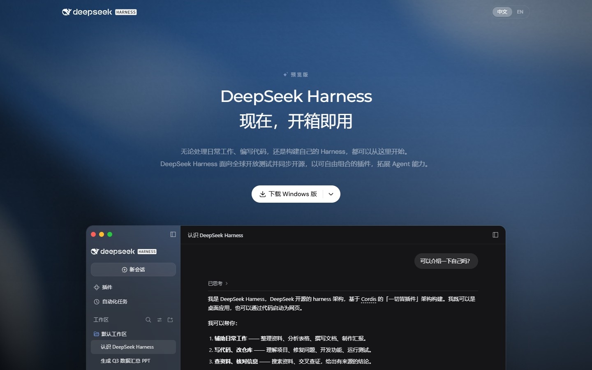<br><strong><a href="https://web-atlas-library.mibxranime.chatgpt.site/#/cases/deepseek-harness">DeepSeek Harness</a></strong><br>深色流体主视觉衬托可观察的产品演示。<br><br><a href="prompts/cases/deepseek-harness.md">Prompt</a> · <a href="docs/cases/deepseek-harness.md">研究</a> · <a href="demos/cases/deepseek-harness/">代码</a></td>
<td width="33%" valign="top">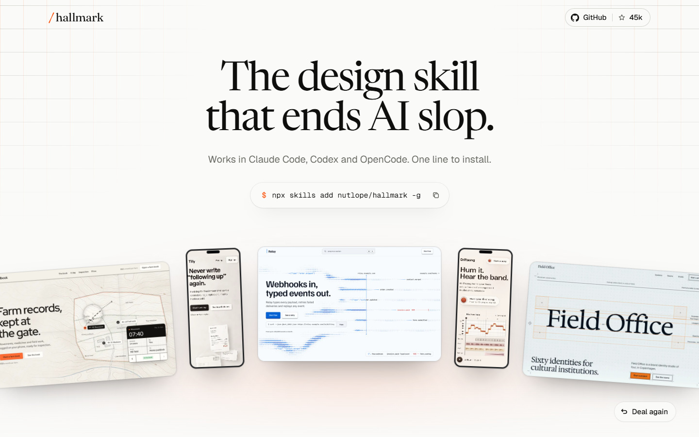<br><strong><a href="https://web-atlas-library.mibxranime.chatgpt.site/#/cases/hallmark">Hallmark</a></strong><br>真实页面作为手牌发出，五十主题网格。<br><br><a href="prompts/cases/hallmark.md">Prompt</a> · <a href="docs/cases/hallmark.md">研究</a> · <a href="demos/cases/hallmark/">代码</a></td>
<td width="33%" valign="top">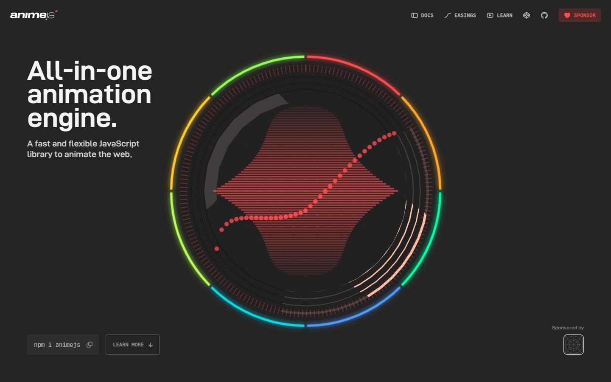<br><strong><a href="https://web-atlas-library.mibxranime.chatgpt.site/#/cases/animejs-site">Anime.js</a></strong><br>彩环仪表盘与八节全屏 API 演示。<br><br><a href="prompts/cases/animejs-site.md">Prompt</a> · <a href="docs/cases/animejs-site.md">研究</a> · <a href="demos/cases/animejs-site/">代码</a></td>
</tr>
</table>

完整画廊见[案例总览](docs/overview.md#案例画廊)，全部条目见[案例索引](docs/cases/README.md)。

## 核心用法

### 在网站上用

从首页跨库搜索，或在案例、巧思、素材列表按分类、用途与关键词筛选。详情左侧运行 Demo，可切换适应、桌面与手机显示，右侧阅读设计拆解、来源与本节目录；复制 Prompt 或下载 Agent 资料包后取材。

收藏保存常用条目，比较页并排查看 2–3 个案例。设计实验室提供协调方案和配色、字体、形状、留白等控件，可试用巧思并导出 JSON 与基础 Prompt；素材的取用方式见[素材使用说明](docs/materials/README.md)。

### 交给 Agent 用

[配套 skill](https://github.com/MIBXR/mibxr-skills/tree/main/skills/web-atlas) 根据需求筛选、比较并取得资料；[agent/catalog.json](agent/catalog.json) 提供案例、巧思与素材的结构化入口。已有本地仓库时，`search` 查找候选，`show` 读取完整说明，`export` 导出源码、素材与文档到新目录：

```sh
node scripts/atlas.mjs search "金融" --limit 3
node scripts/atlas.mjs show stripe-platform
node scripts/atlas.mjs export stripe-platform --out ../stripe-reference
```

巧思与素材使用对应的 `pattern-*`、`material-*` 命令，参数与取材方式见[Agent 取材说明](docs/agent.md)。

### 本地运行

使用 Node.js 22.12 或更新版本，在仓库根目录执行：

```sh
npm install
npm run build
npm run dev
```

默认开发端口为 `5173`，打开终端显示的本地地址；`Ctrl+C` 结束服务。构建与发布见[贡献指南](CONTRIBUTING.md#构建与发布)。

## 目录

| 目录 | 用途 |
| --- | --- |
| `entries/` | 案例、巧思与素材的结构化条目 |
| `demos/` | 可运行作品、素材、制作资料与许可 |
| `docs/` | 使用指南、研究、素材说明与 README 配图 |
| `prompts/` | 构建生成的复用 Prompt |
| `agent/` | 构建生成的目录、索引与 Agent 资料包 |
| `previews/` | 案例、巧思与素材的现成预览图 |
| `data/` | 构建生成的站点数据与素材映射 |
| `site/` | 站点页面、组件、Arc UI 与共享运行时 |
| `scripts/` | 内容构建、检查、检索、导出与发布工具 |

## 许可与署名

站点使用的 Arc UI 许可见 [ARC-UI-LICENSE](site/registry/ARC-UI-LICENSE)。第三方代码、字体、图像与音视频的许可和署名保存在各条目本体的许可文件及 `LICENSES.md` 中。

[使用指南](docs/guide.md) · [贡献指南](CONTRIBUTING.md) · [维护约束](AGENTS.md)
