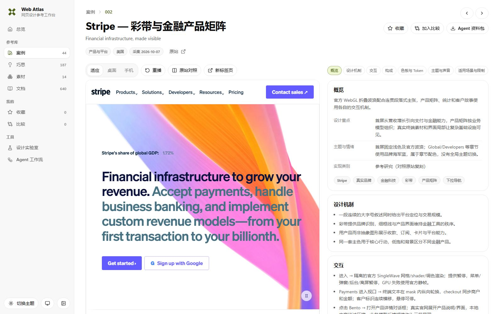

# Web Atlas 使用指南

Web Atlas 提供可亲手体验的案例、巧思与素材，条目按实际内容提供来源、机制说明、Prompt、Demo、画廊或原文资料。

首页提供三类条目入口、跨库搜索、指南与工具导航。主导航包含总览、案例、巧思、素材、文档、收藏、比较和工具；案例浏览位于 `#/cases`，`cases.html` 兼容入口可进入同一列表。

真实网站案例是所标注网址在采集日期的单一快照，保留当时的页面与交互，不随官网后续变化更新。

- **查找**：按产品、游戏/IP、艺术文化、经典语言、示范作品与国家／地区筛选；搜索品牌、配色、布局、交互或约束。分类、地区、搜索与排序保留在 URL 中，支持刷新恢复、浏览器前进／后退和分享筛选结果（例如 `cases.html?category=showcases`）。
- **体验**：在详情内滚动、悬停、切换和播放，也可独立打开完整 Demo。案例、巧思与素材共用适应面板、桌面 1440px、手机 390px 和重播控件。选择适应面板时，Demo 按实际可用宽度排版；选择桌面或手机时，先按目标 CSS 宽度排版，再等比缩小到面板。高度随可用视口调整，长内容在 Demo 内纵向滚动。嵌入与独立 Demo 默认使用公共细滚动条，原作自定义样式或明确的系统滚动条要求优先。
- **比较**：在案例卡片或详情中加入比较，选择2–3项后逐字段并排查看摘要、构成、交互、主题、声音与约束；比较页可添加或移除案例，所选 id 保存在 URL 中。
- **巧思库**：在巧思库按视觉、微动效、页面动效、声音、内容与组织筛选，再按功能用途、来源案例与关键词找可单独借用的机制。巧思详情自动载入当前选中的完整来源 Demo，切换来源时同步载入；“重新定位”可返回观察位置，“重播”重新载入 Demo。每个巧思提供机制、效果、适用范围、Prompt 与来源案例，触发条件、参数和组合信息按实际记录展示。同一机制可以来自多个案例，也可以与其他案例的机制组合。
- **素材库**：在代表性样例中试用组件与资源，按类型、用途与关键词筛选；详情保留参数、安装方式、源码、Prompt、版本、来源与许可证。进入可运行素材的详情后，会自动载入当前样例；切换样例时同步载入，展示框预先按可用视口占位。Google Material Web、手绘 Wired Elements、复古 98.css、Recursive 可变字体与 Shaders 提供不同的组件语言、试排与视觉效果，并保留明确的兼容性后备方案。完整库与作者工具见原始仓库。
- **试验**：在设计实验室中调整配色、字体、布局、留白、形状、图形、层级、质感与动效，直接观察画面变化；深浅主题按背景、表面、文字与强调角色协调变化，JSON 和 Prompt 导出保留实际选择。
- **Agent 工作流**：入口为 `#/tools/workflow`，检索案例索引，下载案例包 JSON 或复制 Agent 入口。
- **复用**：复制案例 Prompt，将品牌、内容和资产换为自己的输入；约束与负向 Prompt 一起使用。
- **Agent 选型**：调用 [web-atlas skill](https://github.com/MIBXR/mibxr-skills/tree/main/skills/web-atlas)，先了解最新目录，再围绕需求迭代筛选，自动取得完整说明、文档和源码。也可从 [Agent 入口](https://web-atlas-library.mibxranime.chatgpt.site/agent.html) 直接取指定案例。
- **桌面与手机**：桌面侧栏可收起，悬停图标显示名称与数量；手机通过顶部导航抽屉切换页面，列表筛选放在底部抽屉。详情在宽屏并排展示舞台与拆解，窄屏上下排列。
- **主题与声音**：网站支持跟随系统／浅色／深色，偏好保存在本地；每个案例说明原站的主题方式、音乐或媒体声音及其交互作用，固定品牌主题保留原貌。
- **收藏**：收藏与备份见“[收藏与迁移](#收藏与迁移)”。
- **文档阅读**：文档操作见“[文档阅读](#文档阅读)”。
- **加载与复用**：使用共享加载器的案例先准备首屏关键图像、字体与视频第一帧，再进入开场；未就绪时显示进度与重试入口。固定版本的大素材在同一站点内缓存，嵌入预览与独立打开共享已经下载的内容。



### 本地运行

需要 **Node.js**。在仓库根目录安装固定依赖、生成内容并启动开发服务：

```bash
npm install
npm run build
npm run dev
```

打开终端显示的 `Local` 地址。`Ctrl+C` 结束服务；不同主机名或端口分别保存收藏。修改条目后运行 `npm run build` 更新数据，再刷新页面。

### 素材来源、加载与缓存

仓库保留完整原始素材，开发服务从本地内容目录加载。本地素材映射可通过[构建与发布](../CONTRIBUTING.md#构建与发布)中的命令生成；使用共享素材运行时的 Demo 默认按 `auto` 先读取自身目录，已映射的大素材加载失败时使用固定提交的 GitHub 备份。独立 Demo 地址可加 `?assets=local` 选择本地素材，或加 `?assets=github` 使用映射媒体；已有查询参数时用 `&assets=…`。GitHub 构建会在输出时把对应 HTML／CSS 引用写入固定 GitHub 地址。

复用单个真实网站 Demo 时，也需携带 `data/asset-sources.js`、`site/runtime/` 中的共享运行时与根目录的 `asset-cache-worker.js`，或连同引用一起迁移这些公共模块。入口 HTML 是项目的一部分，单独下载 HTML 不会包含它依赖的图像、字体和脚本。

`npm run build:site -- --commit <已推送提交的完整 SHA>` 按[构建与发布](../CONTRIBUTING.md#构建与发布)生成部署目录；`npm run build:local` 生成包含全部素材的静态目录，可用于完整本地托管。GitHub 素材固定到部署目录 `data/asset-sources.js` 中的完整提交 SHA，首次下载需要网络。

首屏加载只等待当前画面必要的图片、可见字体和视频首帧，后续章节的资源按需提前准备。进度按已就绪资源项统计，而非下载字节百分比；失败时可以重试或继续浏览。明日方舟与塞尔达保留自己的原站风格加载／声音入口，开场从资源就绪之后开始。音乐由用户启用，首屏加载不等待音乐。

固定 GitHub 地址的媒体使用浏览器 Cache Storage 保存，再次进入时优先复用；完整视频缓存支持字节区间读取与拖动。嵌入预览与独立页面同属一个站点时共享这份缓存。素材按访问加载，缓存最多 256MiB，按存入顺序移除较早的素材。HTML、脚本与样式照常获取当前版本。

素材缓存保存在浏览器 Cache Storage，可通过浏览器的站点数据管理清除。收藏与素材缓存分别保存；缓存缺失时重新下载，参见 [MDN Cache](https://developer.mozilla.org/en-US/docs/Web/API/Cache)。

### 从参考到自己的设计

1. 在对应 Demo 中实际操作，阅读原站观察与本地差异。
2. 复制 `prompts/cases/<id>.md`，填写目标产品、内容、素材、尺寸与观察日期。
3. 保留该风格的网格、层级、比例和状态关系，再调整自己的品牌输入。
4. 按实际功能检查滚动、输入、手机布局、音视频和主题切换。
5. 保存对比截图、改动理由与 Git 提交，方便回看自己的判断。

音频由用户启用；静音视频可播放并提供暂停。真实品牌图片、字体及本地音视频按原比例保存；Apple 的完整产品影片按需播放官方在线流，需要网络。登录、购买、预约和实际服务入口指向官网，不在本库执行。

### 收藏与迁移

案例、巧思与素材收藏保存在当前站点浏览器的 `localStorage`，使用 `web-atlas-favorites` 保存三种条目的 ID，备份格式为 `{"format":"web-atlas-favorites","cases":[],"patterns":[],"materials":[]}`。

刷新页面会保留收藏；更换浏览器、地址或端口后，收藏不共用，清理网站数据会清除收藏。主导航的“收藏”页提供“导出收藏配置”“导入收藏配置”；三类收藏保存在同一个 JSON 文件中。导入时合并本库有效 ID、去重并忽略未知条目。将导出的 JSON 自行纳入 Git，即可保存个人收藏结果。


## 文档阅读

文档中心按分组列出研究、Prompt、复刻说明与素材原文，支持标题与路径搜索，Demo 目录中的文档默认折叠。宽屏正文右侧列出二、三级章节，较窄屏幕把章节目录放在正文上方；手机阅读时通过“返回目录”选择文档。文档与章节位置保存在 URL 中。收录范围与维护流程见 [CONTRIBUTING](../CONTRIBUTING.md#文档分工与唯一位置)，独立 Demo 预览见[案例画廊](overview.md#案例画廊)。
